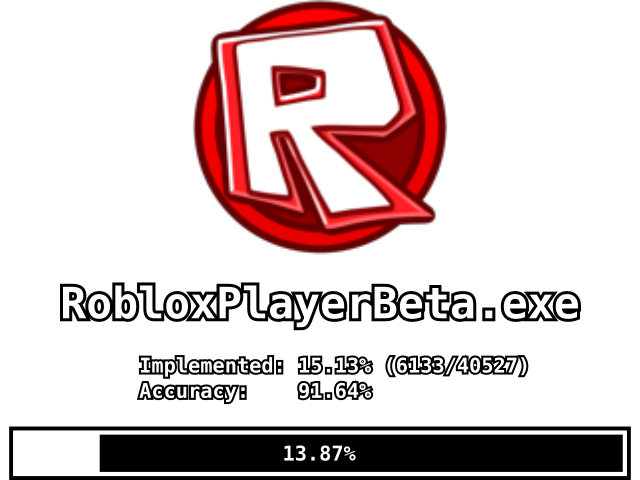
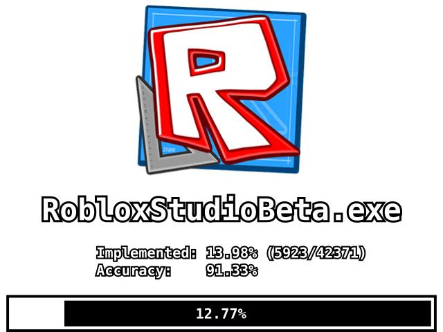

# Project OGRE

[Plan and status](/DECOMP_PLAN.md) | [Rules](/CLAUDE.md)

This is a decompilation of the Roblox Windows client as it was released in October 2013: the Player (0.126.0.39503, built October 23) and Studio (built October 17). We're writing the source back until the original compiler, Visual C++ 2008 SP1, compiles it into the same binaries, instruction for instruction.

We follow the conventions and tooling of [OpenRBX](https://github.com/Asphaltian/OpenRBX), which did the same for the December 2007 client.

Keep in mind that this code reproduces the original release as it was, bugs included. It only builds for 32-bit Windows, and we build it on Linux under wine.

## Progress

<p align="center"><a href="https://mcstealinyabucket.github.io/Project-OGRE/PLAYERPROGRESS.HTML"></a> <a href="https://mcstealinyabucket.github.io/Project-OGRE/STUDIOPROGRESS.HTML"></a></p>

About 10.7% of the Player's 40,468 functions compile to the same instructions as the original, and about 10% of Studio's 42,330. Most of that is third-party code, which is matched in full or nearly: Lua 5.1.4 with Roblox's changes, G3D 8.00 with its zlib and libzip, boost 1.53 and RakNet 4.036. Outside the libraries, about 2,200 functions match in each binary.

The engine core starts from an earlier partial decompilation of the `App` library. It is being re-measured and its class layouts corrected against the 2013 binaries, beginning with `Instance`, the reflection system, `DataModel` and `ScriptContext`.

## Building

You will need:

* Visual C++ 2008 SP1 (`cl` 15.00.30729.01). This is the compiler the original was built with, and no other version produces the same code. `tools/msvc9/assemble.sh` builds a portable copy in `toolchain/msvc9/` from the Visual Studio 2008 Professional DVD and the SP1 ISO.
* wine 10. The wrappers in `tools/msvc9/` run the compiler under wine. Building natively on Windows is untested.
* [CMake](https://cmake.org/) 3.25 or newer, and [Ninja](https://ninja-build.org/).

Then configure and build each target:

```
cmake -G Ninja -S . -B build -DCMAKE_TOOLCHAIN_FILE=cmake/msvc9-wine.cmake
cmake --build build

cmake -G Ninja -S . -B build-studio -DCMAKE_TOOLCHAIN_FILE=cmake/msvc9-wine.cmake -DOGRE_TARGET=STUDIO
cmake --build build-studio --target studio
```

This gives you `build/RobloxPlayerBeta.exe` and `build-studio/RobloxStudioBeta.exe` with their PDBs. Studio builds in its own tree because the original's assert messages record a different build machine path, and we reproduce those paths.

A fresh clone doesn't build yet. Some sources can't be published here: RakNet 4.034 ships under an evaluation licence, pristine G3D 8.00 is no longer downloadable so we patch a later copy, and a few headers are identical to Roblox source. Where an upstream archive exists, `tools/lib/install_libs.py` rebuilds the library from it plus our patches in `staging/`.

## Comparing With the Original

You'll need the original binaries, which aren't distributed here. Make sure their SHA256 matches:

```
326d9c3e3baa18e9a6bdd6e3187ee1a1d2eddbaecf87c57b9e35da8c6857b10d  RobloxPlayerBeta.exe (0.126.0.39503)
68ba1c5fd39ccc535b6ed77a171e3c94fd6d258fd8a5777af428dbbf9b623ba6  RobloxStudioBeta.exe (2013.10.16.1)
```

Install [reccmp](https://github.com/isledecomp/reccmp) and our patch to it:

```
python3 -m venv toolchain/venv
toolchain/venv/bin/pip install -r tools/requirements.txt
sh tools/reccmp-patches/apply.sh
```

The patch makes reccmp read imports from the table the code actually calls through (the Player is wrapped by VMProtect, which adds a second one) and recognise the exception-handling records Visual C++ 2008 writes.

Create `reccmp-user.yml` in the project root and point it at your copies:

```yaml
targets:
  PLAYER:
    path: path/to/RobloxPlayerBeta.exe
  STUDIO:
    path: path/to/RobloxStudioBeta.exe
```

Now you can compare, from each build directory:

```
# the player
cd build && reccmp-reccmp --target PLAYER -S PLAYERPROGRESS.SVG

# studio
cd build-studio && reccmp-reccmp --target STUDIO -S STUDIOPROGRESS.SVG
```

`sh tools/progress.sh` regenerates the images and reports in `docs/`.

## Project Structure

* `Client/` - the engine's static libraries and the client projects, laid out by the source paths the 2013 binaries record
* `3rdparty/` - third-party code the original built against from outside its tree
* `staging/` - pristine third-party sources and our patches to them, each one justified by the original's bytes
* `util/` - headers the decompilation needs
* `cmake/` - the CMake toolchain and modules
* `tools/` - compiler wrappers (`msvc9/`), IDA scripts (`ida/`), library matchers (`lib/`) and other Python tooling
* `reccmp/` - data files for reccmp, generated from the IDA exports
* `ida/exports/` - names and function lists exported from our IDA databases
* `notes/` - daily logs and analysis reports
* `docs/` - progress images and reports

## Contributing

Read [CLAUDE.md](CLAUDE.md) before you start. It holds the project's rules, which apply to people as much as to agents, and [DECOMP_PLAN.md](DECOMP_PLAN.md) has the phases and current status. Never commit the original binaries, IDA databases or any Roblox source code.
